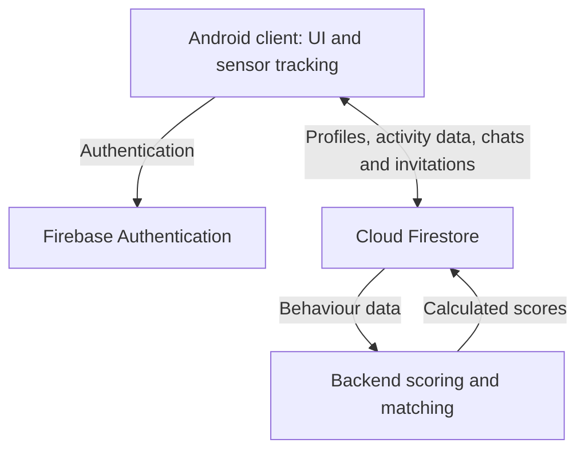

# TrueMatch
### Android dating prototype built around everyday behaviour

TrueMatch explores a question: **could shared daily habits help people discover compatible partners?** The app combines mobile sensing with profile discovery, messaging and date planning, presenting activity categories alongside conventional profile information.

Developed by a six-person team for **COMP90018 - Mobile Computing Systems Programming, University of Melbourne (2025)**.

**[Watch the walkthrough](https://youtu.be/wgXt_u9OY0M)** · **[Explore the Figma prototype](https://www.figma.com/design/owWAblqoTqFcsr2LUPYHXN/TrueMatch-prototype)** · **[Read the technical report](report/truematch_report.pdf)** · **[Download the Android build](apk/app-debug.zip)**

> **Repository scope:** this is a project showcase containing an Android build, the team report and a demonstration link. The Android client and backend source code are not included here. Architecture and implementation details below are documented in the report; this repository cannot be used to build the application from source.

## At a glance

| Area | Project highlights |
| --- | --- |
| Product | Behaviour-based discovery with visible activity categories |
| Mobile experience | Onboarding, profiles, discovery, likes, chats and date invitations |
| Sensing | Steps, mobility, app usage, social app usage and inferred sleep behaviour |
| Cloud integration | Firebase Authentication and Cloud Firestore |
| Design | Figma prototyping, Material components and bottom navigation |
| My focus | UI/UX, Android interfaces, registration and discovery flows, likes and integration debugging |

## Explore the experience

| Journey | What it demonstrates |
| --- | --- |
| **Create a profile** | Email/password authentication, registration and profile information |
| **Discover people** | Profile cards and per-category activity scores to make behavioural signals visible |
| **Express interest** | Likes and a dedicated likes list |
| **Start a conversation** | Chat lists and messaging integrated with Firestore |
| **Plan a date** | Invitations with a time, location and response status |
| **Check in** | Optional QR-based attendance confirmation |

The walkthrough is the quickest way to review the application without installing it.

## My contribution - Zijun Xing

I worked on UI/UX design and Android frontend development, connecting the prototype's user journeys with application data and team-developed backend functionality.

- **Design to implementation:** designed user flows in Figma and implemented Android interfaces for onboarding, registration, discovery and navigation.
- **Registration:** implemented and refined registration screens and frontend account-creation logic.
- **Discovery and likes:** built a usable discovery screen, implemented the likes list and connected navigation between key screens.
- **Data presentation:** updated user-detail screens to display distance, social app usage and sleep information; distinguished missing activity values from genuine zero values.
- **Integration and debugging:** integrated authentication, profile, matching and chat-display functionality, resolved layout/resource issues and refined screens with the team.

These responsibilities are supported by the project report's contribution record and archived commit log, alongside my project experience. Sensing services, matching computation, chat infrastructure and date/QR features were shared team work; the feature list above describes the team product.

## System architecture

The Android client collects behavioural signals and presents user journeys. Firebase handles identity and shared data storage. A separate backend retrieves behavioural data, computes scores and writes results back for the client to display.

The report describes repository-based data access and an MVVM authentication flow. Background tracking services handle sensing separately from UI interactions.

## Technical highlights

| Component | Documented approach |
| --- | --- |
| Android UI | Java-based interface work, XML layouts, ConstraintLayout, RecyclerView and Material components |
| Identity and data | Firebase Authentication, Cloud Firestore, repository abstractions and real-time listeners |
| Mobile sensing | Step counter, location, usage statistics, camera-based QR scanning and a sleep proxy |
| Background processing | Shared tracker-service patterns, scheduled updates and wake-lock coordination |
| Matching | Normalised behavioural categories and backend scoring/similarity calculations |
| Interaction design | Figma user flows, light/dark themes and visible invitation states |

### A small detail with practical impact: missing versus zero

An absent activity measurement is different from a measured value of zero. I updated the interface to distinguish these states, so missing sensor information would not be presented as a real behavioural measurement.

### From discovery to meeting

The team connected discovery, conversation, scheduling and QR check-in into one flow. This extends the prototype beyond profile browsing and shows how mobile interfaces, shared cloud state and user actions fit together.

## Reviewing the Android build

1. Start with the **[walkthrough video](https://youtu.be/wgXt_u9OY0M)** and **[technical report](report/truematch_report.pdf)**.
2. For hands-on review, download and extract **[apk/app-debug.zip](apk/app-debug.zip)**.
3. Install the extracted APK on a compatible Android device or emulator. The device may require permission to install an app from the browser or file manager.
4. Review the app's requested permissions before enabling the sensing features you want to explore.

**Runtime status:** the archive contains a debug APK. The current availability of the original Firebase project, backend services and demonstration accounts has not been verified. Live functionality may depend on those services and on device sensor/permission support. A reproducible source build and a supported Android-version matrix are not provided in this repository.

## Prototype limitations

- This is a university prototype, not a production dating service.
- Sleep is inferred from device usage rather than measured directly.
- Sensor availability, permissions and missing data affect the activity categories shown.
- The report documents implementation and team self-evaluation; it does not establish real-world matching accuracy or user outcomes.
- The original report is retained as a team deliverable. Its historical test-account details are not maintained access instructions.

Future development could include a source release where permitted, repeatable setup instructions, current demo data, clearer data-consent controls and evaluation of matching quality.

## Repository guide

| Location | Contents |
| --- | --- |
| [`apk/`](apk/) | Archived Android build distributed as a ZIP |
| [`report/truematch_report.pdf`](report/truematch_report.pdf) | Team report, architecture, data model and archived contribution/commit records |
| [`video/readme.md`](video/readme.md) | Original walkthrough link |

## Team and attribution

TrueMatch was developed by **Zijun Xing, Shasha Wu, Zherui Wang, Yash Arjun Aslekar, Nathan Charles Lopes and Karl Jorge Cleres Andreo**. See the report for the team's contribution matrix and development history.

This page presents my contribution within that collaborative project.
