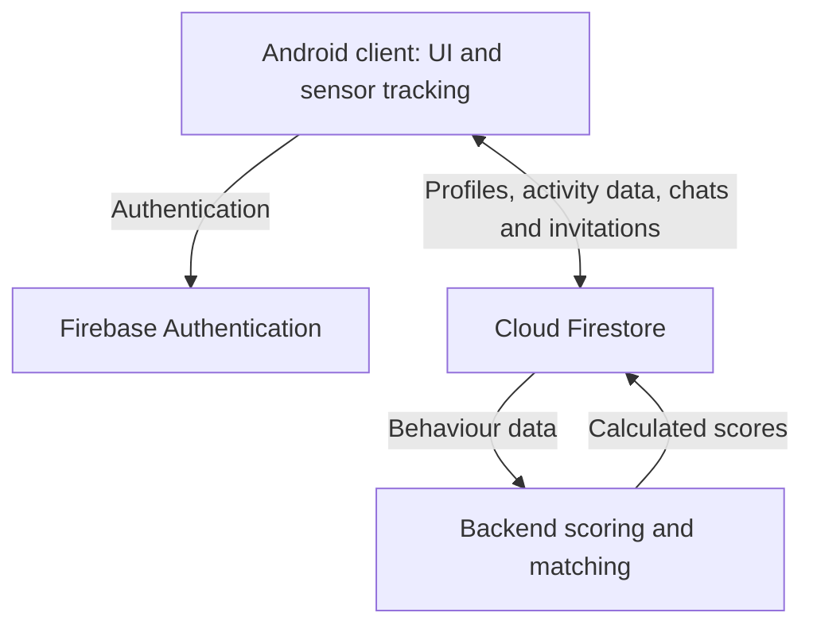

# System Architecture & Data

The Android client collects behavioural signals and presents user journeys. Firebase handles identity and shared data storage. A separate backend retrieves behavioural data, computes scores and writes results back for the client to display.

The report describes repository-based data access and an MVVM authentication flow. Background tracking services handle sensing separately from UI interactions.

## Technical highlights

| Component | Documented approach |
| --- | --- |
| Android UI | Java-based interface work, XML layouts, ConstraintLayout, RecyclerView and Material components |
| Identity and data | Firebase Authentication, Cloud Firestore, repository abstractions and real-time listeners |
| Mobile sensing | Step counter, location, usage statistics, camera-based QR scanning and a sleep proxy |
| Background processing | Shared tracker-service patterns, scheduled updates and wake-lock coordination |
| Matching | Normalised behavioural categories and backend scoring/similarity calculations |
| Interaction design | Figma user flows, light/dark themes and visible invitation states |

### A small detail with practical impact: missing versus zero

An absent activity measurement is different from a measured value of zero. I updated the interface to distinguish these states, so missing sensor information would not be presented as a real behavioural measurement.

### From discovery to meeting

The team connected discovery, conversation, scheduling and QR check-in into one flow. This extends the prototype beyond profile browsing and shows how mobile interfaces, shared cloud state and user actions fit together.

## Firestore data model

The report's appendix describes these logical entities; this is historical documentation, not an inspection of a live database.

| Entity | Purpose |
| --- | --- |
| users | Profile information and normalised activity categories |
| likes | Liker, liked user and timestamp |
| matches | Participants, active flag and timestamp |
| chats | Participants, last message, timestamp and unread state |
| dates | Time, location, participants, invitation status and associated chat |

The date lifecycle includes pending, accepted, declined, expired and checked-in states. The report describes Firestore transactions/listeners supporting state changes.

## Data interpretation

Sleep is inferred from usage patterns, not directly measured. Permission and sensor availability affect collected signals. Missing measurements must remain distinct from measured zero values; see the [contribution case study](Personal-Contribution.md).

---
[Wiki Home](Home.md) · [Navigation](_Sidebar.md) · [Repository overview](../../README.md)
